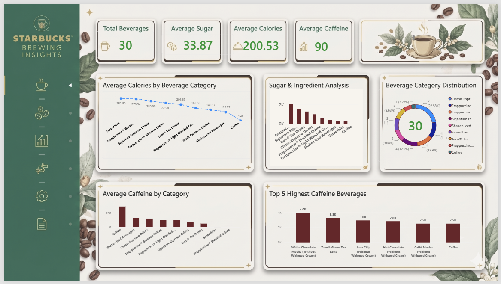

# Starbucks-PowerBI-Analysis
# ☕ Starbucks Store Performance & Sales Analysis (Power BI)

## 📌 Project Overview
An interactive Power BI dashboard analyzing Starbucks store metrics, sales performance, product categories, and customer insights.

## 📊 Dashboard Preview

## 🔑 Key Insights & KPIs
- Total Sales & Revenue Trends
- Best Performing Products / Categories
- Customer Demographics & Footfall Analysis

## 🛠️ Tools Used
- **Power BI Desktop** (DAX, Data Modeling, Visuals)
- **Power Query** (ETL & Data Cleaning)
- **Dataset:** Starbucks Dataset (CSV/Excel)

## 📂 Repository Contents
- `Starbucks_Analysis.pbix`: Interactive Power BI Report
- `data/`: Raw and cleaned datasets
- `images/`: Dashboard screenshots
